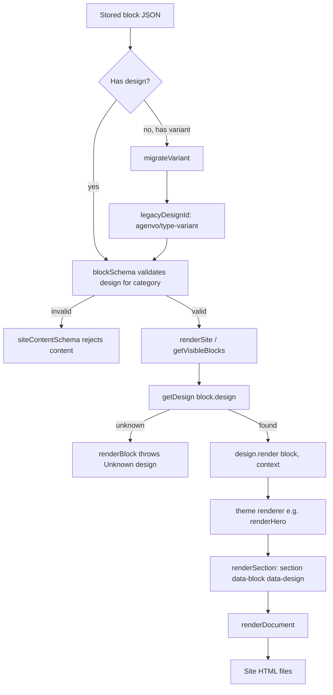
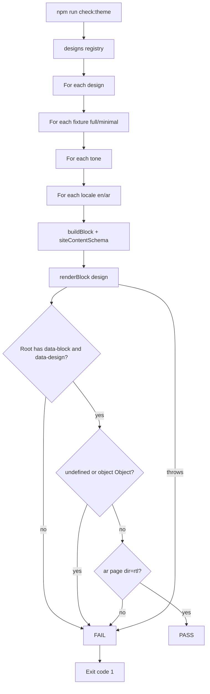
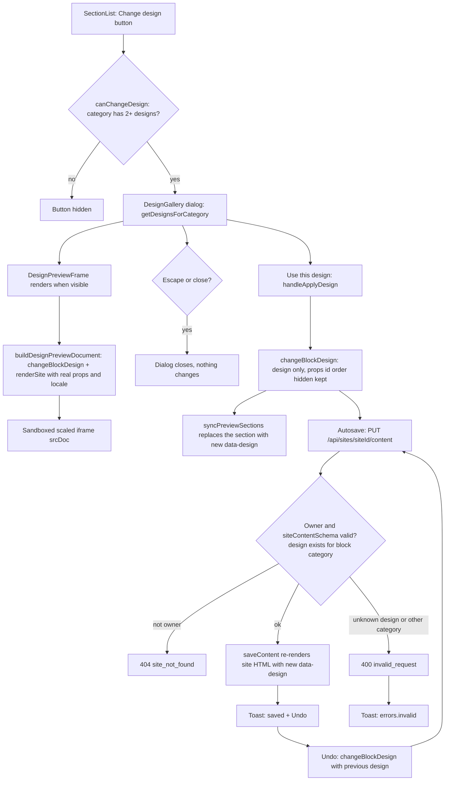

# Block designs

Stored blocks render through the design registry; old `variant` content is migrated on read.

Swapping a section's design in the editor (L2). Only `block.design` changes; no AI call, no credits.

