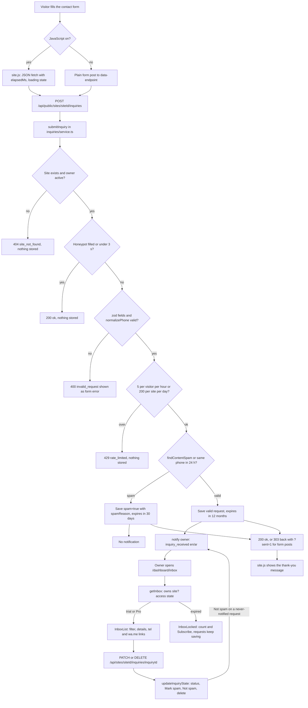
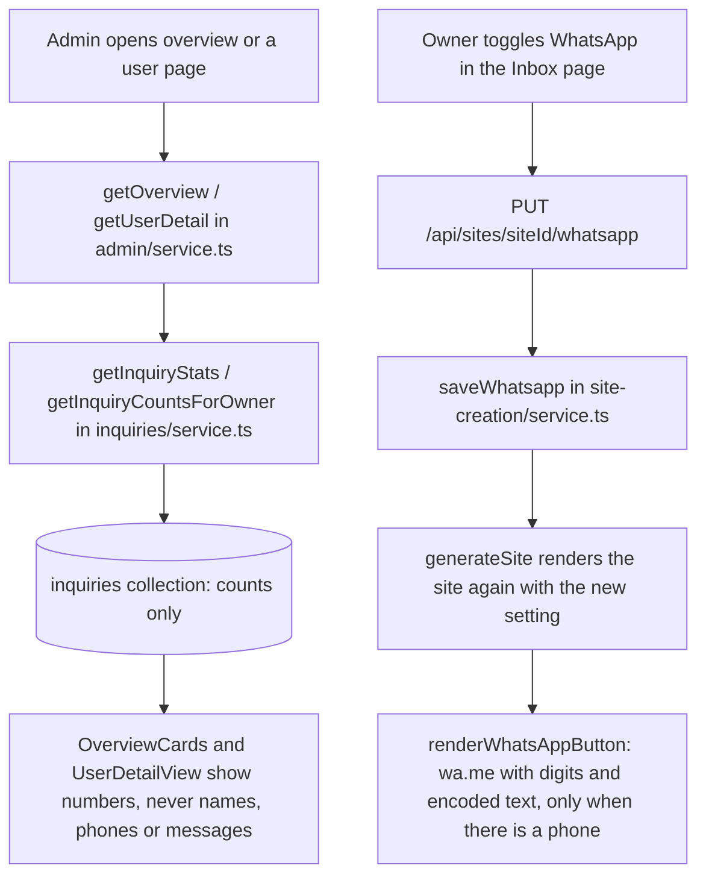

# Inquiries (W1): website requests, WhatsApp button, Inbox, admin counts

A visitor of a generated website sends a quote request; it is spam-checked, saved, and shown in the owner's Inbox with a notification. The admin sees counts only.

Admin counts and the WhatsApp button:

