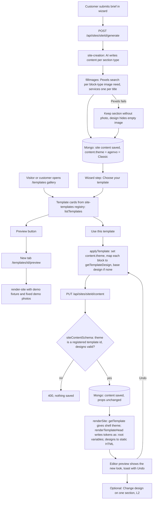

# Flow: templates (pick a template after the content is written)

Plan: `docs/templates-plan.md`. Status: **T1 built** (template model, Classic, `applyTemplate`, content-level
image needs) and **T2 built** (template Aurelia). T3–T8 (gallery, pick screens, more templates) are not built yet.
This file is updated in each milestone.

**Aurelia (T2), in plain words:** a dark luxury look: charcoal pages, thin gold lines, a faint diamond pattern over
the hero photo, big gold serif titles with one italic line, and a gold-outlined menu button. It has its own menu,
footer and style file (no outside scripts), a wave edge under the hero and above the numbers, and extra layouts:
circle-icon services, photo panels, a big-number band and project cards with facts. Every section type has an
Aurelia design, so any content fits. Preview locally with `npm run templates:render-sample -- aurelia`
(writes `.template-samples/aurelia/`).

Built in T1: `site-templates/` (registry, Classic = id `agenvo`), `applyTemplate` in `site-editor/apply-template.ts`,
`content.theme` validated as a template id, template colors and fonts written as CSS variables in the page head
(nothing extra for Classic, so old sites render the same bytes), and `services.items[].image` filled from Pexels.

## In plain words

**1. The content comes first.** The customer fills in the brief. The AI writes the text for every section
(hero, services, projects, contact…), the SEO title and description, and the system searches Pexels for photos
that match the business. All of this is saved as the site's **content**. The content has the same shape for
every template: each section has a type (for example "services") and the fields that type always has.

**2. Then the customer picks a template.** A template is a ready look: colors, fonts, spacing, the top menu and
footer, and one design for each type of section. Every template knows how to show every section type, so any
content fits any template. If a template has no own design for a section type, it uses the basic design, which
still takes the template's colors and fonts.

**3. Looking at templates costs nothing.** The gallery shows each template with fixed demo text and fixed demo
photos (chosen once by us). "Preview" opens the full demo site in a new tab. No AI and no Pexels search happen
when someone looks at the gallery.

**4. Applying a template only changes the look.** When the customer clicks "Use this template", the system sets
the template on the site and gives every section that template's design. The text, photos, services, projects,
reviews and section order do not change. The site is saved and rebuilt right away. Undo brings the old template
back.

**5. Changing your mind is free.** The customer can change the template at any time from the dashboard or the
editor, and still change one section alone with "Change design" (L2).

## Flowchart

